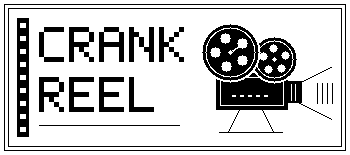

# Crank Reel

[日本語](README.ja.md)

Crank Reel is a hand-cranked pixel animation studio for Playdate. Draw up to 32 frames on a 16 × 16 monochrome canvas, then turn the crank to screen your reel. Crank faster to speed up the picture and music. Turn backward to rewind both, or stop to hold the picture.



## Install

Download `CrankReel.pdx.zip` from the **Assets** section of a release in this repository. Upload the ZIP on the [Playdate Sideload page](https://play.date/account/sideload/), then find Crank Reel in your Playdate's Game Library. For USB installation or details on refreshing the library, see the [official Sideload guide](https://help.play.date/games/sideloading/).

For the Playdate Simulator, extract the ZIP and open `CrankReel.pdx` from **File → Open**.

## Make and screen a reel

1. Press **A** on the title screen to open the shelf. Choose **New reel** to draw your own, or choose **Jellyfish** to try the crank.
2. In the studio, move the cursor with the D-pad and press **A** to toggle a pixel. Use the crank to select frames. Press **B** to open the tools, including **Film strip**, **Generate motion**, and **Save reel**.
3. Choose **Screen this reel** to preview. Crank or press Left/Right to step through the reel. **A** toggles looping and **B** goes back. On the shelf, **Right** edits a reel and **Left** returns to the title.

For Jellyfish, **Right** opens an editable copy. The sample itself still allows BGM and loop changes. If its frames were edited in an older version, **B → Restore sample (keep backup)** restores the original frames and keeps the edited reel as a separate backup.

In **Film strip**, choose a frame, press **A** to pick it up, then press **A** at the destination. **Up** undoes the last edit. Use **Frame hold** to give a frame 1–4 times the normal share of crank travel. **In-between frames** generates movement between two adjacent frames with the same shape at different positions.

Select a reel on the shelf and press **B** to manage it. You can duplicate it or choose its soundtrack from **Popcorn**, **Moon Drift**, **Dark Alley**, and **Flash Bang**. Your own reels can also be renamed or deleted.

## Share a reel

1. Select a reel and choose **B → Export reel code**. Retrieve `Export.crankreel` from Crank Reel's save data folder. A subsequent export replaces this file.
2. Send the file or the text beginning with `CR1-`. On the receiving side, save it as plain text in `Import.crankreel` and place it in Crank Reel's save data folder.
3. Select **New reel** on the shelf and press **B**. Check the title and first frame in the preview, then press **A** to add a separate copy.

On hardware, the save data folder is under `PLAYDATE/Data/` in USB Data Disk mode. Look for the Crank Reel folder associated with your installation. In the Simulator, use **File → Reveal Data folder**. Start the app once before looking for its data folder. The code carries the title, frames, loop setting, holds, and soundtrack. Crank Reel accepts UTF-8 text, including files with a byte-order mark.

## Build from source

Install the [Playdate SDK](https://play.date/dev/) and make its `pdc` compiler available on your PATH. From the repository root:

```sh
pdc Source CrankReel.pdx
```

Open the result in the Simulator or install it on your Playdate. The v0.8.2 build was compiled with SDK 3.1.2.

## Run the tests

From the repository root, run `lua tests/reel_code.lua` with Lua 5.3 or later.

## Credits and licensing

Crank Reel is licensed under the [MIT License](LICENSE). See [NOTICE.md](NOTICE.md) for third-party notices.
